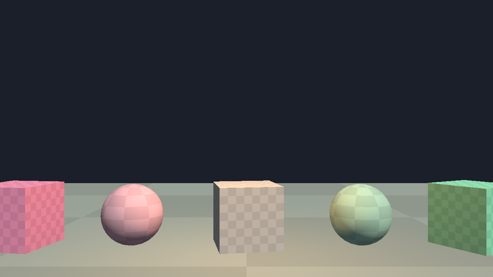

<p align="center"></p>

# sbox-rs

An experimental port of [s&box](https://github.com/Facepunch/sbox-public) to Rust + wgpu: a scene/component runtime, loaders for Source 2 resource formats, and a wgpu renderer.



Site: https://lakomoor.github.io/sbox-rs/

> **Unofficial project.** Not affiliated with Facepunch Studios or Valve. No game files are included in this repository; to open real assets you need your own copy (see [Running with real assets](#running-with-real-assets)). Licensed under MIT.

## Status

This is **not** a complete port. The original s&box is roughly a million lines of C# on top of a closed-source Source 2 native core. This project reimplements the pieces listed below, based on inspecting the shipped file formats.

Conventions follow s&box: X forward, Y left, Z up; angles are pitch/yaw/roll in degrees.

| Crate | Mirrors | What it does |
|---|---|---|
| `sbox-math` | `Sandbox.System/Math` | Vec/Quat (glam), `Angles`, `Transform`, `BBox`, `Ray`, `Plane` |
| `sbox-scene` | `Sandbox.Engine/Scene` | `Scene` / `GameObject` / `Component`, s&box lifecycle order, hierarchy, deferred destroy, fixed update |
| `sbox-resource` | closed Source 2 native core | `*_c` container, binary KV3, `vtex_c` textures (BC1-7, LZ4/ZSTD mips, PNG), VBIB vertex/index buffers (meshopt), `vmdl_c` models (multi-mesh, skeleton, skin weights), `vmat_c` materials, `anim_c` animations, `skel_c`, virtual file resolver |
| `sbox-render` | closed Source 2 native core | wgpu renderer: meshes, GPU skinning, materials with BC textures, directional + point lights, depth, off-screen rendering |
| `sbox-app` | `Launcher` | demo window / model viewer / screenshot tool |

### Verified against real game data

Checked on the `game/` directory produced by the official `Setup` step:

- Resource container: 6878 / 6878 files
- KV3 blocks: 7014 / 7014 (including external LZ4-linked blob blocks)
- `vtex_c` textures: 2618 / 2618, mip sizes match byte for byte
- `vmdl_c` meshes: 743 / 744 (about 3 million triangles), normals decode to unit length
- `anim_c` clips: 1284 / 1284 parse; skinned playback of the citizen character verified visually. 198 clips show large frame-to-frame rotation jumps, some from genuinely fast motion, some possibly decoder edge cases

### Not done yet

- Animation blending / state graphs (`vanmgrph`), root motion, additive clips, in-model (`ANIM` block) animations
- External `vmesh_c` references, `.shader_c` shaders, PBR / normal maps / shadows
- VPK, audio (`vsnd_c`), physics, input, networking, UI
- Scene / prefab serialization
- Scripting: s&box game code is C#; it needs either a Rust API or an embedded .NET runtime

## Build and run

```
git clone https://github.com/LakoMoor/sbox-rs
cd sbox-rs
cargo run -p sbox-app --release
```

Controls: WASD / QE to move, arrow keys to look, Esc to quit.

### Running with real assets

1. Clone [sbox-public](https://github.com/Facepunch/sbox-public) and run its `Setup.bat` / `Setup.sh` (downloads the native binaries and compiled resources, ~10 GB).
2. Open a compiled model, optionally with an animation clip; materials, textures and skeletons are resolved from the enclosing `game/` directory:

```
cargo run -p sbox-app --release -- path/to/game/core/models/dev/gordon_at_desk.vmdl_c
cargo run -p sbox-app --release -- path/to/game/addons/citizen/Assets/models/citizen/citizen.vmdl_c --anim path/to/game/addons/citizen/Assets/clips/avatarmenu_entry_walkin_01.anim_c
```

### Screenshots without a window

```
sbox-app [model.vmdl_c] --screenshot out.png [--time seconds]
```

Renders one frame off-screen and writes a PNG.

### Format survey tools

`crates/sbox-resource/examples/` contains the tools used to reverse-engineer and validate the formats (`survey`, `vtexsurvey`, `vbibsurvey`, `meshsurvey`, `kv3tree`, ...):

```
cargo run --release -p sbox-resource --example survey -- path/to/game
```

## Roadmap

1. Animation graphs, additive clips, root motion; clothing (`clothing_c`) and mesh groups
2. `vmesh_c` references, shaders, normal maps / PBR, shadows
3. VPK and a proper virtual file system
4. Scene / prefab loading (`*.scene`, `*.prefab`)
5. Physics (rapier), audio, input, networking, UI
6. Scripting story for game code

## License

MIT. s&box and Source 2 belong to their respective owners.
