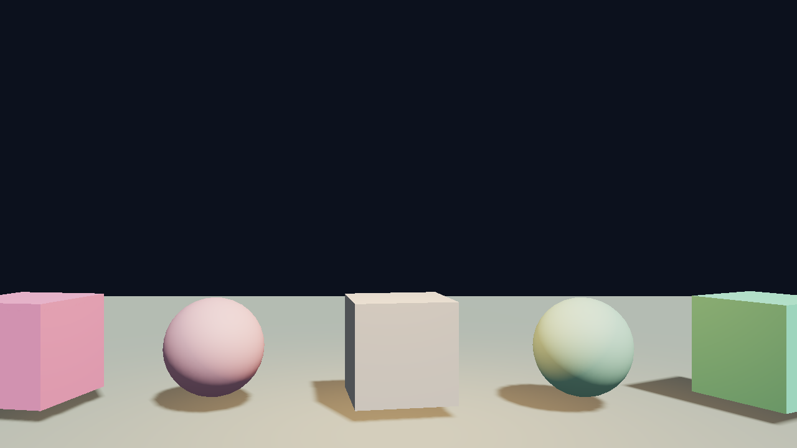

<p align="center"></p>

# sbox-rs

An experimental port of [s&box](https://github.com/Facepunch/sbox-public) to Rust + wgpu: a scene/component runtime, loaders for Source 2 resource formats, and a wgpu renderer.



Site: https://lakomoor.github.io/sbox-rs/

> **Unofficial project.** Not affiliated with Facepunch Studios or Valve. No game files are included in this repository; to open real assets you need your own copy (see [Running with real assets](#running-with-real-assets)). Licensed under MIT.

## Status

This is **not** a complete port. The original s&box is roughly a million lines of C# on top of a closed-source Source 2 native core. This project reimplements the pieces listed below, based on inspecting the shipped file formats.

Conventions follow s&box: X forward, Y left, Z up; angles are pitch/yaw/roll in degrees.

| Crate | Mirrors | What it does |
|---|---|---|
| `sbox-math` | `Sandbox.System/Math` | Vec/Quat (glam), `Angles`, `Transform`, `BBox`, `Ray`, `Plane` |
| `sbox-scene` | `Sandbox.Engine/Scene` | `Scene` / `GameObject` / `Component`, s&box lifecycle order, hierarchy, deferred destroy, fixed update, systems/resources, `.scene`/`.prefab` JSON loading |
| `sbox-net` | closed networking layer (Steam Networking) | own authoritative client-server protocol over UDP: connect handshake with retry, per-tick input, MTU-split transform snapshots; the transport only, no scene replication yet |
| `sbox-physics` | Havok wrapper in the closed core | rapier-based `Rigidbody`, box/sphere/plane colliders, parent-body compound colliders, fixed-step system |
| `sbox-resource` | closed Source 2 native core | `*_c` container, binary KV3, `vtex_c` textures (BC1-7, LZ4/ZSTD mips, PNG), VBIB vertex/index buffers (meshopt), `vmdl_c` models (multi-mesh, skeleton, skin weights), `vmat_c` materials, `anim_c` animations, `vanmgrph_c` animation graphs, `sound_c` sound events, `vsnd_c` sounds (PCM16 / MP3 / Ogg Vorbis / Opus, 739 / 739 shipped files), `skel_c`, `.vpk` v2 packages, virtual file resolver |
| `sbox-render` | closed Source 2 native core | wgpu renderer: meshes, GPU skinning, materials with BC textures, directional + point lights, 2048² directional shadow map with PCF, BC6H HDR cubemap sky, ACES tone mapping, normal maps (derivative TBN), GGX specular with RMA / metalness, off-screen rendering |
| `sbox-app` | `Launcher` | demo window / model viewer / screenshot tool, audio playback (rodio) |

### Verified against real game data

Checked on the `game/` directory produced by the official `Setup` step:

- Resource container: 6878 / 6878 files
- KV3 blocks: 7014 / 7014 (including external LZ4-linked blob blocks)
- `vtex_c` textures: 2618 / 2618, mip sizes match byte for byte
- `vmdl_c` meshes: 744 / 744 (about 3 million triangles; external `vmesh_c` references are resolved through the game file system), normals decode to unit length
- `anim_c` clips: 1284 / 1284 parse; skinned playback of the citizen character verified visually. 198 clips show large frame-to-frame rotation jumps, some from genuinely fast motion, some possibly decoder edge cases

### Not done yet

- Prefabs (`prefab_c`, same JSON as scenes with a `RootObject`) all 58 load, and their particles are simulated (sphere / cone emitters, curves, additive or alpha billboards), with sprite-sheet frames decoded from the `vtex_c` extra data (cell origins; frame chosen by particle age, not by the authored sequence curves), but collisions, trails, `Decal` and post-processing are ignored

- Animation graphs are evaluated in a reduced form (poses are computed per node: sequence, blend, 2D blend, selector, state machines with parameter/time/tag conditions, `Subtract` / `Add` additive layers; the additive convention `base * delta` is unverified against the real engine); bone-mask nodes blend per bone using the citizen weight lists read from the model source `.vmdl_prefab` (parent blend space only; the model-space variants are treated the same), IK, look-at / aim, root motion and in-model (`ANIM` block) animations are not
- `.shader_c` shaders are compiled GPU bytecode and are not translated: materials use one fixed PBR shader, with the common `F_*` flags mapped (`F_ALPHA_TEST`, `F_TRANSLUCENT`, `F_UNLIT`); backface rendering, self-illumination, detail textures, multiblend and tint masks are ignored
- Input: actions Forward/Backward/Left/Right/Jump/Run/Duck/Use/Reload/Attack1-3, `released`, mouse wheel; the controller supports ducking (slower, lower eye) but has no crouch collider, slopes/stairs or air control
- UI: `Renderer::overlay` draws textured screen-space rectangles after post-processing; `sbox-app/src/ui.rs` adds a small retained UI (panels, labels, buttons with hover and click hit testing; `--hud "text"`, `--ui-demo` with Play / Quit). Text fields support click focus, typed characters, Backspace and Enter / Escape to submit (`--ui-demo` has a name field). There is no layout engine, scrolling, Tab navigation, caret movement, selection, clipboard or IME, and `ScreenPanel` / `WorldPanel` components (Razor) are ignored
- Networking
- `Decal` is drawn as a flat translucent quad with its `.decal_c` colour texture (no projection onto surfaces, no sequences)
- `ModelCollider` and map props use the model's collision shapes (convex hulls, spheres and capsules from the `PHYS` block or the referenced `vphys_c`, as one compound collider); multi-part (skeletal) physics is placed in the rest pose with `m_bindPose` (checked against mesh bounds on a cardboard box, a crate, a chair and `citizen`), but its `m_joints` are not simulated, so the parts form one rigid body; triangle-mesh shapes and `phys_hinge` constraints are not read, and models without hulls / spheres / capsules fall back to the bounding box; `MeshComponent` polygon meshes are decoded from the half-edge `Topology` blob and rendered per material (UVs from `TextureCoord`, flat normals, no collision, component-local `Position`/`Rotation` ignored)
- Post-processing: the scene renders to an Rgba16F target and a post pass applies `Tonemapping` (ACES / AgX approximation / Reinhard with an EV exposure and an opt-in (`--auto-exposure`) stateless auto exposure: 8x8 grid geometric-mean luminance mapped to mid grey, clamped to Minimum/MaximumExposure read as multipliers (unverified against s&box), no temporal adaptation), `Bloom` (32-tap single-pass blur of the bright-pass), `Vignette`, `Sharpen` (4-neighbour unsharp mask) and `DepthOfField` (24-tap gather weighted by each sample's circle of confusion, read from the depth buffer; distance is view-space depth), `AmbientOcclusion` (12-tap SSAO from the depth buffer, normals from depth neighbours, applied to the lit image, no denoise), `ChromaticAberration` (red/blue channels shifted by `Offset` pixels), `GradientFog` (distance fog from the depth buffer with a height fade over the fog object's Z; `CubemapFog` tints the fog with the scene's sky cube sampled along the view ray, `Blur` picks the mip; it uses the sky set by the map / `Renderer::set_skybox` rather than a per-component texture and the property names are unverified). `env_volumetric_fog_volume` map entities become `FogVolume` boxes (up to 4) integrated along the view ray in the post pass; density (1/4096 per unit) and the dim scatter colour are tuned by eye on `toolscene_lighting_interior_dark`, the only bundled map with one; rotation/scale, `falloffexponent`, `shape` and the controller's fade/draw-distance keys are ignored; `ScreenSpaceReflections` is ignored. Components saved with `__enabled: false` are skipped by the scene loader
- `SpotLight` is a real cone light (smoothstep between inner and outer angle; no shadows; shares the 8-slot point light array)
- Maps: world nodes (`vwrld_c` / `vwnod_c`) are loaded with `--map <maps/x/world.vwrld_c> --game <game dir>`; map entities (`vents_c`) are decoded (`sbox_resource::vents`: MurmurHash2-hashed keys, typed values) and `light_environment`, `light_omni`, `light_spot`, `env_sky`, `info_player_start` and `prop_*` are spawned; other entity classes, lightmaps, light probes and visibility are ignored
- Prefab instances/variables, most scene component types (only models, lights, camera, rigidbody and colliders are mapped)
- Scripting: game code is written as Rust components (see [Scripting](#scripting)); C# is not executed

## Build and run

```
git clone https://github.com/LakoMoor/sbox-rs
cd sbox-rs
cargo run -p sbox-app --release
```

Controls: WASD / QE to move, arrow keys to look, Esc to quit.

Drive the citizen with its animation graph: `sbox-app citizen.vmdl_c --graph citizen.vanmgrph_c --param move_x=150 --param wish_groundspeed=150 --param move_groundspeed=150`.

Play a sound: `sbox-app --sound some.vsnd_c [--loop]`.

Pass `--play` with `--scene` to replace the fly camera with a physics-driven first-person capsule controller (WASD, Shift to run, Space to jump, click to capture the mouse).

### Running with real assets

1. Clone [sbox-public](https://github.com/Facepunch/sbox-public) and run its `Setup.bat` / `Setup.sh` (downloads the native binaries and compiled resources, ~10 GB).
2. Open a compiled model, optionally with an animation clip; materials, textures and skeletons are resolved from the enclosing `game/` directory:

```
cargo run -p sbox-app --release -- path/to/game/core/models/dev/gordon_at_desk.vmdl_c
cargo run -p sbox-app --release -- path/to/game/addons/citizen/Assets/models/citizen/citizen.vmdl_c --anim path/to/game/addons/citizen/Assets/clips/avatarmenu_entry_walkin_01.anim_c
```

### Loading a scene

```
cargo run -p sbox-app --release -- --scene path/to/game/samples/sweeper/Assets/scenes/minimal.scene_c
```

Loads the JSON scene, spawns models/lights/camera and runs the rapier simulation.

### Screenshots without a window

```
sbox-app [model.vmdl_c] --screenshot out.png [--time seconds]
```

Renders one frame off-screen and writes a PNG.

### Format survey tools

`crates/sbox-resource/examples/` contains the tools used to reverse-engineer and validate the formats (`survey`, `vtexsurvey`, `vbibsurvey`, `meshsurvey`, `kv3tree`, ...):

```
cargo run --release -p sbox-resource --example survey -- path/to/game
```

## Scripting

Decision (the less invasive of the two options in the original plan): game code is ported to Rust and plugged in as components. An embedded .NET runtime is not planned for now; nothing in the scene API prevents adding one later.

A component implements `sbox_scene::Component` with the s&box lifecycle (`on_awake`, `on_enabled`, `on_start`, `on_update`, `on_fixed_update`, `on_pre_render`, `on_disabled`, `on_destroy`) and reads shared state from resources such as `Input`:

```rust
struct Spinner { speed: f32 }

impl Component for Spinner {
    fn on_update(&mut self, scene: &mut Scene, h: Handle) {
        let mut t = scene.local_transform(h.go);
        t.rotation = Quat::from_rotation_z((self.speed * scene.delta).to_radians()) * t.rotation;
        scene.set_local_transform(h.go, t);
    }
    impl_component_any!();
}
```

To instantiate one from a `.scene` / `.prefab` file, map its `__type` name in `SceneLoader::create` (`crates/sbox-app/src/assets.rs`), as `CubeController` (a port of the sweeper sample's `CubeController.cs`) is. Unmapped types are counted and listed in the log as "unsupported components".

## Roadmap

Done (see "Not done yet" for the approximations): scene / prefab loading, maps from VPK (world nodes), models with external meshes, materials with the common `F_*` flags, animation graphs (reduced), particles, sounds, input + a basic character controller, a post-processing chain (tone mapping, bloom, vignette, sharpen, depth of field, SSAO, chromatic aberration, gradient fog), a screen-space UI overlay, `MeshComponent` / `Decal` / `SpotLight` / `ModelCollider`; map props get a bounding-box collider and `prop_physics` is a dynamic rigid body.

Open, in rough order of value:

1. More map entity classes (`func_shatterglass` is spawned as a static model prop without breaking and `light_ortho` as a wide spot light, both approximations; `phys_hinge` only occurs inside model physics data (`[PR#]part` targets) and needs the joints, which are not simulated; light probe volumes need baked GI, which is not ported); the `vents_c` format itself is decoded
2. `ScreenSpaceReflections`
3. UI beyond the basic panels / buttons / text fields: scrolling, text selection and placing the caret by mouse (the caret moves with the arrow keys / Home / End and Delete works), nested layouts (only a single flex-like `layout::Stack` exists: row / column, padding, gap, fixed / grow sizes, cross-axis alignment, used by `--ui-demo`), and `ScreenPanel` / `WorldPanel` (Razor) compatibility
4. Real shader translation: `.shader_c` is compiled GPU bytecode, so this means re-implementing the shaders by hand per material family
5. Networking: `sbox-net` has the UDP transport (chosen design: authoritative server, own protocol); still missing: replicating scene objects / components, client-side prediction and interpolation, RPCs, and wiring into `sbox-app` (`--host` / `--join`)
6. Scripting: Rust components are the supported path; an embedded .NET runtime would be needed to run original C# unchanged

## License

MIT. s&box and Source 2 belong to their respective owners.
