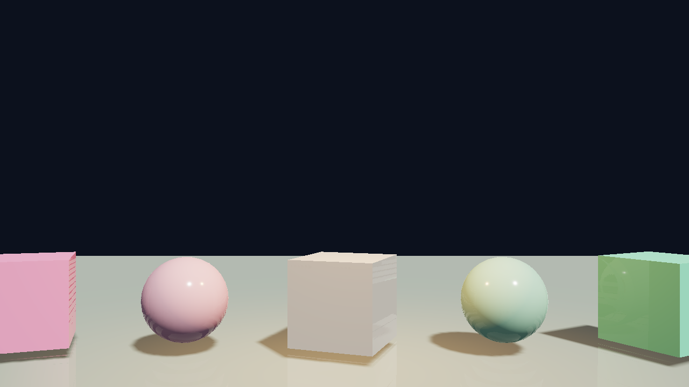
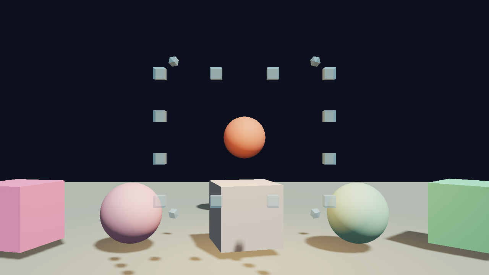
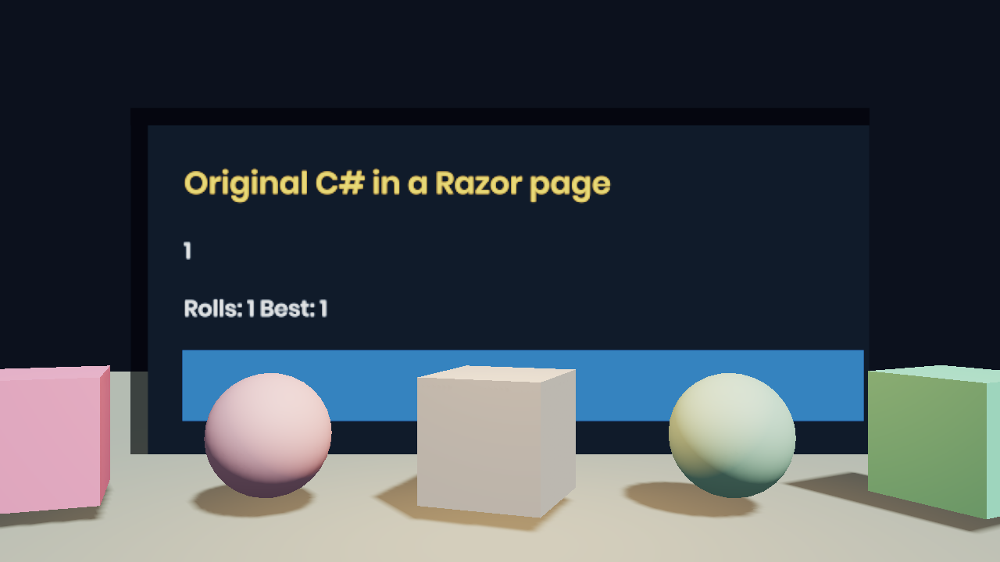

<p align="center"></p>

# sbox-rs

An experimental port of [s&box](https://github.com/Facepunch/sbox-public) to Rust + wgpu: a scene/component runtime, loaders for Source 2 resource formats, and a wgpu renderer.


| | | |
|---|---|---|
|  |  |  |
| screen-space reflections | `func_shatterglass` shards | Razor page running original C# |

Site: https://lakomoor.github.io/sbox-rs/

> **Unofficial project.** Not affiliated with Facepunch Studios or Valve. No game files are included in this repository; to open real assets you need your own copy (see [Running with real assets](#running-with-real-assets)). Licensed under MIT.

## Status

This is **not** a complete port. The original s&box is roughly a million lines of C# on top of a closed-source Source 2 native core. This project reimplements the pieces listed below, based on inspecting the shipped file formats.

Conventions follow s&box: X forward, Y left, Z up; angles are pitch/yaw/roll in degrees.

| Crate | Mirrors | What it does |
|---|---|---|
| `sbox-math` | `Sandbox.System/Math` | Vec/Quat (glam), `Angles`, `Transform`, `BBox`, `Ray`, `Plane` |
| `sbox-scene` | `Sandbox.Engine/Scene` | `Scene` / `GameObject` / `Component`, s&box lifecycle order, hierarchy, deferred destroy, fixed update, systems/resources, `.scene`/`.prefab` JSON loading |
| `sbox-net` | closed networking layer (Steam Networking) | own authoritative client-server protocol over UDP: connect handshake with retry, per-tick input, MTU-split transform snapshots; transform replication of `NetworkId` objects |
| `sbox-physics` | Havok wrapper in the closed core | rapier-based `Rigidbody`, box/sphere/plane colliders, parent-body compound colliders, fixed-step system |
| `sbox-resource` | closed Source 2 native core | `*_c` container, binary KV3, `vtex_c` textures (BC1-7, LZ4/ZSTD mips, PNG), VBIB vertex/index buffers (meshopt), `vmdl_c` models (multi-mesh, skeleton, skin weights), `vmat_c` materials, `anim_c` animations, `vanmgrph_c` animation graphs, `sound_c` sound events, `vsnd_c` sounds (PCM16 / MP3 / Ogg Vorbis / Opus, 739 / 739 shipped files), `skel_c`, `.vpk` v2 packages, virtual file resolver |
| `sbox-render` | closed Source 2 native core | wgpu renderer: meshes, GPU skinning, materials with BC textures, directional + point lights, 2048² directional shadow map with PCF, BC6H HDR cubemap sky, ACES tone mapping, normal maps (derivative TBN), GGX specular with RMA / metalness, off-screen rendering |
| `sbox-app` | `Launcher` | demo window / model viewer / screenshot tool, audio playback (rodio) |

### Verified against real game data

Checked on the `game/` directory produced by the official `Setup` step:

- Resource container: 6878 / 6878 files
- KV3 blocks: 7014 / 7014 (including external LZ4-linked blob blocks)
- `vtex_c` textures: 2618 / 2618, mip sizes match byte for byte
- `vmdl_c` meshes: 744 / 744 (about 3 million triangles; external `vmesh_c` references are resolved through the game file system), normals decode to unit length
- `anim_c` clips: 1284 / 1284 parse; skinned playback of the citizen character verified visually. 198 clips show large frame-to-frame rotation jumps, some from genuinely fast motion, some possibly decoder edge cases

### Not done yet

- Prefabs (`prefab_c`, same JSON as scenes with a `RootObject`) all 58 load, and their particles are simulated (sphere / cone emitters, curves, additive or alpha billboards), with sprite-sheet frames decoded from the `vtex_c` extra data (cell origins; frame chosen by particle age, not by the authored sequence curves), but collisions, trails, `Decal` and post-processing are ignored

- Animation graphs are evaluated in a reduced form (poses are computed per node: sequence, blend, 2D blend, selector, state machines with parameter/time/tag conditions, `Subtract` / `Add` additive layers; the additive convention `base * delta` is unverified against the real engine); bone-mask nodes blend per bone using the citizen weight lists read from the model source `.vmdl_prefab` (parent blend space only; the model-space variants are treated the same), IK, look-at / aim, root motion and in-model (`ANIM` block) animations are not
- `.shader_c` shaders are compiled GPU bytecode and are not translated: materials use one fixed PBR shader, with the common `F_*` flags mapped and the shader name picking a hand-written approximation (`sbox-app/src/families.rs`: standard for `complex` / `generic` / `simple` / `foliage` / `fur`, `skin` without subsurface scattering, `water_simple` as smooth translucent blue, `citizen_eye` (4 materials) as a painted bitmap (`families::eye_texture`: white sclera, iris colour / radius / centre and pupil size from the material, darkening toward the iris rim; the real shader's procedural detail is left out; unit-tested; on the full human model seen from the front (`--cam-yaw 180` swings the screenshot camera round the model) with `--cam-zoom 6 --cam-target 0 0 30` (screenshot camera moves closer to a point) the eyes show a brown iris, dark pupil and white sclera that look right, though the face is dark because the sun is behind the model, and the real shader's detail is absent), `terrain` (2 materials) has no parameters or textures in its `.vmat` (the terrain data lives elsewhere), so it stays standard, `glass` (6 materials, visors and lenses) as a smooth translucent dielectric (alpha at most 0.35, roughness at most 0.15; no refraction or blur; on the gas mask the lenses show as dark translucent discs and on the trooper helmet the visor as teal glass with the inside faintly visible (`--cam-yaw 180`), which looks plausible but was not compared with the real renderer), `blendable` as its first colour layer, `tools_*` hidden; none of these is checked against the real shaders; sky, glass and terrain shaders are not special-cased (`F_ALPHA_TEST`, `F_TRANSLUCENT`, `F_UNLIT`); backface rendering, self-illumination, detail textures, multiblend and tint masks are ignored
- Input: actions Forward/Backward/Left/Right/Jump/Run/Duck/Use/Reload/Attack1-3, `released`, mouse wheel; the controller supports ducking (slower, lower eye) but has no crouch collider, slopes/stairs or air control
- UI: `Renderer::overlay` draws textured screen-space rectangles after post-processing; `sbox-app/src/ui.rs` adds a small retained UI (panels, labels, buttons with hover and click hit testing; `--hud "text"`, `--ui-demo` with Play / Quit). Text fields support click focus, typed characters, Backspace and Enter / Escape to submit (`--ui-demo` has a name field). There is no layout engine, scrolling, Tab navigation, caret movement, selection, clipboard or IME, and `ScreenPanel` / `WorldPanel` components (Razor) are ignored
- Networking
- `Decal` is drawn as a flat translucent quad with its `.decal_c` colour texture (no projection onto surfaces, no sequences)
- `ModelCollider` and map props use the model's collision shapes (convex hulls, spheres, capsules and triangle meshes from the `PHYS` block or the referenced `vphys_c`, as one compound collider); multi-part (skeletal) physics is placed in the rest pose with `m_bindPose` (checked against mesh bounds on a cardboard box, a crate, a chair and `citizen`), but as a collider the parts form one rigid body. Ragdolls exist as data and physics only: `phys::ragdoll` reads the parts (own-space shapes, rest pose, mass) and the twist / swing joints (`m_nType` 4: frames, swing and twist limits; `citizen` gives 16 parts and 11 of its 15 joints, the other types are skipped), `sbox_physics::Joint` makes them rapier joints (a pendulum test), and `assets::spawn_ragdoll` creates one dynamic body per part (a chain falls without coming apart in a test); in the app, `sbox-app <model.vmdl_c> --ragdoll` lets the R key (or `--ragdoll-after <seconds>`) turn the model into a ragdoll: the bodies fall onto a floor at the model's lowest point and a `RagdollSkin` component skins the model's meshes from them (each bone with a physics part follows its body, the others their nearest such ancestor); seen with `citizen` (standing pose, then a body lying on the floor with limbs bent at the joints, no clipping or self-collision checks beyond the joint limits), only a screenshot, no comparison with the original; hinge joints of a model's physics data (`m_nType` 3: wheels, lids; the shipped wheely bin and cardboard box have them) are read with their twist limit and angular motor (target speed and max torque, mapped to a velocity drive whose damping equals the torque: friction when the target is zero; `--ragdoll` on the wheely bin was looked at: with the hinge turning about the frames' Y axis (`Joint::hinge_axis`; X tipped the bin over at once and Z flipped it, so Y was chosen by looking, not from the data) it stays upright for four seconds with wheels and lid attached, the motor making no visible difference, and the open cardboard box's flaps hang and flop on their edges about the same axis while the box stays put (three seconds, screenshot); rigid meshes without skin weights are bound to the bone of the nearest physics part, a guess), while linear motors, springs and other types are not; a survey of every shipped model (`examples/jointdrives`) finds 119 joints, 41 hinges (type 3) and 78 twist / swing (type 4), none with a linear limit, a spring frequency, a strength or a moving motor, so nothing shipped needs them (the `Joint` component itself has hinges, velocity motors and spring drives, covered by tests: a hinge spins at the motor speed and a spring settles on its target angle) and models without a physics part per bone (props with one body) do not get the switch; triangle meshes (`m_Vertices` / `m_Triangles` blobs, `Shape::TriMesh` in `sbox-physics`; a ball rests on one in a test, and the mesh of a real model matches its visual bounds) are hollow: fine for static props, but a dynamic body whose only shape is one gets no sensible mass, and `phys_hinge` constraints are not read, and models without hulls / spheres / capsules fall back to the bounding box; `MeshComponent` polygon meshes are decoded from the half-edge `Topology` blob and rendered per material (UVs from `TextureCoord`, flat normals, no collision, component-local `Position`/`Rotation` ignored)
- Post-processing: the scene renders to an Rgba16F target and a post pass applies `Tonemapping` (ACES / AgX approximation / Reinhard with an EV exposure and an opt-in (`--auto-exposure`) stateless auto exposure: 8x8 grid geometric-mean luminance mapped to mid grey, clamped to Minimum/MaximumExposure read as multipliers (unverified against s&box), no temporal adaptation), `Bloom` (32-tap single-pass blur of the bright-pass), `Vignette`, `Sharpen` (4-neighbour unsharp mask) and `DepthOfField` (24-tap gather weighted by each sample's circle of confusion, read from the depth buffer; distance is view-space depth), `AmbientOcclusion` (12-tap SSAO from the depth buffer, normals from depth neighbours, applied to the lit image, no denoise), `ChromaticAberration` (red/blue channels shifted by `Offset` pixels), `GradientFog` (distance fog from the depth buffer with a height fade over the fog object's Z; `CubemapFog` tints the fog with the scene's sky cube sampled along the view ray, `Blur` picks the mip; it uses the sky set by the map / `Renderer::set_skybox` rather than a per-component texture and the property names are unverified). `env_volumetric_fog_volume` map entities become `FogVolume` boxes (up to 4) integrated along the view ray in the post pass; density (1/4096 per unit) and the dim scatter colour are tuned by eye on `toolscene_lighting_interior_dark`, the only bundled map with one; rotation/scale, `falloffexponent`, `shape` and the controller's fade/draw-distance keys are ignored; `ScreenSpaceReflections` is ignored. Components saved with `__enabled: false` are skipped by the scene loader
- `SpotLight` is a real cone light (smoothstep between inner and outer angle; no shadows; shares the 8-slot point light array)
- Maps: world nodes (`vwrld_c` / `vwnod_c`) are loaded with `--map <maps/x/world.vwrld_c> --game <game dir>`; map entities (`vents_c`) are decoded (`sbox_resource::vents`: MurmurHash2-hashed keys, typed values) and `light_environment`, `light_omni`, `light_spot`, `env_sky`, `info_player_start` and `prop_*` are spawned; other entity classes, lightmaps, light probes and visibility are ignored
- Prefab instances/variables, most scene component types (only models, lights, camera, rigidbody and colliders are mapped)
- Scripting: game code is written as Rust components (see [Scripting](#scripting)); C# is not executed

## Build and run

```
git clone https://github.com/LakoMoor/sbox-rs
cd sbox-rs
cargo run -p sbox-app --release
```

Controls: WASD / QE to move, arrow keys to look, Esc to quit.

Drive the citizen with its animation graph: `sbox-app citizen.vmdl_c --graph citizen.vanmgrph_c --param move_x=150 --param wish_groundspeed=150 --param move_groundspeed=150`.

Play a sound: `sbox-app --sound some.vsnd_c [--loop]`.

Pass `--play` with `--scene` to replace the fly camera with a physics-driven first-person capsule controller (WASD, Shift to run, Space to jump, click to capture the mouse).

### Running with real assets

1. Clone [sbox-public](https://github.com/Facepunch/sbox-public) and run its `Setup.bat` / `Setup.sh` (downloads the native binaries and compiled resources, ~10 GB).
2. Open a compiled model, optionally with an animation clip; materials, textures and skeletons are resolved from the enclosing `game/` directory:

```
cargo run -p sbox-app --release -- path/to/game/core/models/dev/gordon_at_desk.vmdl_c
cargo run -p sbox-app --release -- path/to/game/addons/citizen/Assets/models/citizen/citizen.vmdl_c --anim path/to/game/addons/citizen/Assets/clips/avatarmenu_entry_walkin_01.anim_c
```

### Loading a scene

```
cargo run -p sbox-app --release -- --scene path/to/game/samples/sweeper/Assets/scenes/minimal.scene_c
```

Loads the JSON scene, spawns models/lights/camera and runs the rapier simulation.

### Screenshots without a window

```
sbox-app [model.vmdl_c] --screenshot out.png [--time seconds]
```

Renders one frame off-screen and writes a PNG.

### Format survey tools

`crates/sbox-resource/examples/` contains the tools used to reverse-engineer and validate the formats (`survey`, `vtexsurvey`, `vbibsurvey`, `meshsurvey`, `kv3tree`, ...):

```
cargo run --release -p sbox-resource --example survey -- path/to/game
```

## Scripting

Two paths. Game code can be ported to Rust and plugged in as components (below). Original C# can also run unchanged inside Razor pages: `sbox-dotnet` embeds .NET through `hostfxr` (`netcorehost`); its managed side (`crates/sbox-dotnet/managed`, built with `dotnet build -c Release -o bin`) compiles a page's `@code` members with the Roslyn that ships in the installed SDK (so the SDK, .NET 10, is needed) into a class, sets the page's values on it, calls a method and returns all simple fields / properties and the `Log` output. With `--dotnet` a page's `@code` block is compiled this way: its fields and properties (including `=>` ones, LINQ, lambdas) give the values the markup reads, and a button whose handler is not a built-in or `csharp.rs` one calls the C# method of that name and takes the state back (`page.rs`). Seen: `docs/demo/dice.razor` on a `--world-panel`, a click on its button ran `Roll()` (`Log.Info` line in the log) and the page showed `Rolls: 1 Best: 1` and the computed summary (screenshots `docs/img/dotnet-0.png` and `dotnet-1.png`). Engine API: `managed/Engine.stub.cs` is a small stand-in compiled with every page (`Log`, `Time`, `RealTime`, `RealTimeSince` / `Until`, `Game`, `Input` (nothing pressed), an empty `Scene`, `Panel` / `PanelComponent` with `StateHasChanged` / `SetClass` / lifecycle virtuals, the `[Parameter]` / `[Property]` / `[Sync]` / `[Title]` attributes); it does not touch a scene, so `OnUpdate` and the other lifecycle methods are never called. Measured on the 208 shipped pages with a code block (`page.rs` test): 2 compile with only `Log`, 19 with these stubs; the rest need names that belong to the menu / Steam services (`Package` 84 pages, `MenuUtility` 45, `MenuProject`, `Friend`, `Party*`, `Workshop*`, `Discovery`, ...), which have no counterpart here and would be the next to stub or port one by one; a page that fails to compile is reported in the log and keeps the small `csharp.rs` subset; state crosses as strings and only numbers, bool and strings come back; computed properties are re-read after a click, not when Rust changes a value; one runtime per process, started by `--dotnet` (SDK at `C:/Program Files/dotnet`, or `SBOX_DOTNET_ROOT` / `SBOX_MANAGED_DIR`); not tried on the shipped pages beyond the demo and tests (`sbox-dotnet`: compile errors, state, `Log`; `page.rs`: LINQ / lambda page).

A component implements `sbox_scene::Component` with the s&box lifecycle (`on_awake`, `on_enabled`, `on_start`, `on_update`, `on_fixed_update`, `on_pre_render`, `on_disabled`, `on_destroy`) and reads shared state from resources such as `Input`:

```rust
struct Spinner { speed: f32 }

impl Component for Spinner {
    fn on_update(&mut self, scene: &mut Scene, h: Handle) {
        let mut t = scene.local_transform(h.go);
        t.rotation = Quat::from_rotation_z((self.speed * scene.delta).to_radians()) * t.rotation;
        scene.set_local_transform(h.go, t);
    }
    impl_component_any!();
}
```

To instantiate one from a `.scene` / `.prefab` file, map its `__type` name in `SceneLoader::create` (`crates/sbox-app/src/assets.rs`), as `CubeController` (a port of the sweeper sample's `CubeController.cs`) is. Unmapped types are counted and listed in the log as "unsupported components".

## Roadmap

Done (see "Not done yet" for the approximations): scene / prefab loading, maps from VPK (world nodes), models with external meshes, materials with the common `F_*` flags, animation graphs (reduced), particles, sounds, input + a basic character controller, a post-processing chain (tone mapping, bloom, vignette, sharpen, depth of field, SSAO, chromatic aberration, gradient fog), a screen-space UI overlay, `MeshComponent` / `Decal` / `SpotLight` / `ModelCollider`; map props get a bounding-box collider and `prop_physics` is a dynamic rigid body.

Open, in rough order of value:

1. More map entity classes (`func_shatterglass` is a model prop that a body moving faster than 150 u/s near its bounds replaces with 16 falling 8-unit shards (`shatter.rs`; unit-tested, bounds are those of the model unrotated, shards take the model's first material, no contact events so it is speed and position only, seen in the demo: `--glass-demo` puts a translucent pane and a ball flying at it at 500 u/s, and the screenshots show the pane whole, then 16 shards in a grid with the ball past it (zero gravity there, so the shards hang; a few tumble where the ball clipped them); not seen on a map: the only shipped `func_shatterglass` entities are two in the `advertising_board` map prefab, which `--map` cannot load on its own) and `light_ortho` as a wide spot light, both approximations; `phys_hinge` only occurs inside model physics data (`[PR#]part` targets) and needs the joints, which are not simulated; light probe volumes need baked GI, which is not ported); the `vents_c` format itself is decoded
2. `ScreenSpaceReflections` exists as an approximation: the scene pass writes a second target (octahedral world normal, roughness, metalness; opaque surfaces only), and the post pass marches the mirror ray through view space against the depth buffer (48 growing steps, 5 binary refinements), adds the colour found there weighted by Fresnel, roughness (nothing above 0.5, like the reference cutoff), screen edges and ray length. Seen on the demo scene (`--ssr`, which also makes its materials glossy): faint reflections of the objects in the floor and of the floor in the spheres, with stripe artefacts on box sides where the steps are coarse. Missing against the reference: half-resolution trace with bilateral upscale, reflecting the previous frame (so no reflection of other reflections or transparent surfaces), tile classification; a hit is blurred with a five-tap ring whose radius grows with roughness and ray length (not a proper cone / mip blur), and a miss falls back to the sky cubemap in the mirror direction, but only when the scene has a `CubemapFog` (that component supplies the cubemap and tint); the demo has none; `--sky <vmat> --cubefog` (with `--game`) were added to try it, with `--sky materials/dev/default_sky.vmat --game <game dir>` (paths are relative to `core`, not prefixed with it) the demo shows the sky and the glossy floor's reflections of the objects, with a black band between the floor edge and the sky (the cubemap's lower half); the fallback has an off switch for comparisons (`SBOX_NO_SSR_SKY=1`): with `--cubefog` on, switching only it off changes the lower part of the frame by 5.9/255 on average (up to 155 on single pixels), so the fallback is active and adds the sky to reflections; whether it looks right was not judged.
3. UI beyond the basic panels / buttons / text fields: scrolling inside nested containers: `ui::ScrollArea` scrolls its own widgets, clipped with a scissor rectangle per draw (`UiRect::clip`), the wheel goes to the innermost area under the pointer that has room and otherwise to the page, and a Razor element with a fixed `height` and `overflow: scroll` / `auto` becomes one (hit tests and scrolling are unit-tested; the clipping and the Razor-built area were not looked at in a window; no scroll bars, no dragging, no keyboard scrolling, areas inside areas are not nested). Done for text fields: a mouse click places the caret and dragging selects in a text field, from per-character pixel offsets measured when the text changes; Ctrl+C / X / V use the system clipboard via `arboard`; the caret moves with the arrow keys / Home / End, Shift extends a selection, Ctrl+A selects all, typing / Backspace / Delete replace it; the mouse wheel scrolls panels, buttons and labels when `content_height` exceeds the window, which only `--razor` pages set, and text fields do not scroll), nested layouts (only a single flex-like `layout::Stack` exists: row / column, padding, gap, fixed / grow sizes, cross-axis alignment, used by `--ui-demo`), and `ScreenPanel` / `WorldPanel` (Razor) compatibility: `sbox-app/src/razor.rs` parses `.razor` files (directives, `@code` text, element tree with attributes, `@expr`, `@if` / `@foreach` / `else` blocks, `@{ }`, comments; C# is kept as text and never run) and all 322 files in the s&box checkout parse (the last two failed on generic arguments such as `Enum.GetValues<Group>()` inside code blocks, which were read as elements; a `<` right after an identifier is no longer a tag); `--razor <file>` draws the static part as one vertical flow (`razor_ui.rs`: `root` / `.panel` / `.card` containers as panels, `h1`-`h6` / `p` / `label` / `span` as text, `<button>` as a button; expressions, `@if` / `@foreach`, `<style>` are skipped); a CSS subset (`style.rs`: `<style>` rules for `tag`, `.class`, `tag.class` and comma lists plus inline `style="..."`; `color`, `background-color`, `font-size`, `padding`, `gap`, `width`, `height` in px, `flex-direction: row`; colour and font size inherit). Data binding is a flat string dictionary (`--bind Name=Value`): `@Name`, `value=@Name` attributes and `@if (Flag) {..} else if (!Other) {..} else {..}` (truthy = not empty / `false` / `0`) are resolved; `@foreach (var x in Items) {..}` repeats its body once per line of the `Items` value (`@x`, `@x.Index`, and `@x.Name` for lines like `Name=Ann;Score=3`); a dotted name such as `@Player.Name` is looked up as a plain key (`--bind Player.Name=Ann`); method calls, real member access on objects and any other C# are dropped. `onclick=@Handler` gives the button the handler's name as its id; a click runs the Rust handler of that name registered on the page (`page.rs`: `Page::on(name, |values| Effect)`; built in: `Quit`, `Increment` / `Decrement` on `Count`, `Toggle` on `Show`), which changes the bound values, and the page is laid out again (unit-tested; not watched in a window). Handlers are Rust closures over the values, plus a tiny C# subset from the page's own `@code` block (`sbox-app/src/csharp.rs`): literal `int` / `float` / `bool` / `string` fields become starting values and parameterless `void` methods of simple statements (`X++`, `X--`, `X = expr`, `X += expr`, `X -= expr`, with literals, values, `!X`, one `+` / `-`) become click handlers (measured on the shipped pages by a test: of 208 pages with a code block only 2 yield a runnable method (4 methods in all) and 32 literal fields are found, and no page has all its `void` methods supported, so on the shipped content this subset is nearly irrelevant; a scan of what the 208 code blocks contain: auto-properties in 164, `BuildHash` overrides in 133, lambdas in 160, `=>` properties in 105, `OnUpdate`-style overrides in 65, `async` in 62, collections in 46, loops in 41, `Game.` / `Input.` / `Time.` / `Scene.` calls in 40, `Log.` in 23; auto-properties with a literal initialiser count as fields, giving 38; read-only `T Name => expr;` properties with the same small expressions or an interpolated string `$"..{Name}.."` are evaluated into the values each time the page is laid out, covered by a page test; across the 208 shipped pages that finds only 2 such properties; the engine calls those pages make are mostly `Log.Warning` / `Log.Info` (23 pages, now run as log lines), `Scene.GetAll`, `Game.InGame`, `Game.Cookies.*` and `Game.Overlay.Show*Modal` (Steam overlay, not portable), and adding `Log` did not make any further page fully supported); everything else in C# is skipped and never runs. SCSS nesting is flattened (`&.on`, `&, &.x`, and plain nesting like `.a { .b {} }` as a descendant selector); selectors may chain compounds with descendant and `>` child combinators (matched against the ancestors' tags and classes, ordered by specificity), but sibling combinators, pseudo-classes (`:hover`), other units (%, em), margins, borders, flex grow / wrap / alignment, or `WorldPanel` from scenes (the component is loaded with its size / scale / look-at flag, but no scene panel gets a page): `--world-panel <file.razor>` (with a path argument inside the game directory for the font, and `--bind`) lays a page out at 512x512, draws it on the CPU into a bitmap (`page::bitmap`: filled panels / buttons, text from the 4x glyph raster box-filtered; scroll areas unclipped) and shows it as an unlit translucent quad 600 units in front of the camera, `--world-panel-look` makes it face the camera; seen in a screenshot, a left click casts a ray from the camera through the cursor (`worldpanel::camera_ray` / `panel_uv` / `hit_button`, covered by unit tests), finds the button under the hit, runs its handler and redraws the bitmap (seen working: `--click <x> <y>` presses at a window pixel before a `--screenshot`, and a page with a button, `Count: @Count` and the built-in `Increment` handler went from `Count: 0` to `Count: 1` on the world quad; a real mouse in a live window was not tried; no hover, no scrolling, no occlusion test against the scene) and no shadow is cast. A scene's `ScreenPanel` component (opacity, scale, z-index) is loaded, and its opacity and scale are applied to the `--razor` page (scale multiplies positions and font sizes, opacity the alpha; z-index is stored only, `AutoScreenScale` is ignored)
4. Real shader translation: `.shader_c` is compiled GPU bytecode, so this means re-implementing the shaders by hand per material family
5. Networking: `sbox-net` has the UDP transport (authoritative server, own protocol) and `replication` (objects with a `NetworkId` have their world transform broadcast by the server and eased in by the client; `sbox-app --host <addr>` / `--join <addr>` number the Rigidbody objects in scene order, so both sides must load the same map / scene, and a client simulates props with its own physics). Checked end to end only as far as the handshake between two processes; missing: spawning / despawning, component replication, collision / gravity / jumping for players (the host glides each connected client's object along its input at 250 u/s, `RemotePlayers`; every player object gets a 32x32x72 box body tinted by its id on host and clients, and on the host a kinematic collider (`Rigidbody::kinematic`, new in `sbox-physics`: follows the object's transform and pushes dynamic bodies) so players shove props; nothing was checked on screen), packet loss handling for snapshots beyond dropping stale ones and the delta scheme: a snapshot holds only the entities that changed since the newest tick the client acknowledged (`SnapshotAck`, sent once all parts of a tick have arrived; the server keeps 64 ticks of full states as bases, and a new client or one whose base fell out of the history gets everything), so an unchanged world costs an empty packet and a lost packet repairs itself because its changes stay in the next delta (covered by loopback tests); entities that vanished from the base are announced in the snapshot (`removed`, up to 32 ids per packet), the client forgets them and `--join` destroys their objects (loopback test); rotations travel as four i16 (24 bytes per entity instead of 32, error under 1/32767 per component); positions are still full f32. Client-side prediction of the local player exists (`replication::Prediction`: inputs carry their frame time, the server applies each exactly once with the same `move_step` and echoes the last applied input in every snapshot, the client replays unacknowledged inputs on top of the server position; covered by tests, and wired into `--join` for the local player object, which the camera does not follow yet); other objects are shown 100 ms in the past and blended between the two snapshots around that time (`replication::Interpolator`, no extrapolation: they stop when snapshots stop), the client camera rides on the predicted player (arrow keys still look, WASD no longer fly it); props are predicted: the client runs them in its own physics and `props::reconcile` eases each toward the server's position (`replication::correct_prop`: ignored under 0.5 units, eased over about 1/8 s, snapped beyond 64 units), client-side players are kinematic colliders too, so the local player's push on a prop is predicted; two real processes (`--host 127.0.0.1:27015` and `--join` with `--screenshot`) connected and the joining client rendered the demo scene with a `Connected` event, but a screenshot of its first seconds does not show props moving or other players, so nothing past the handshake was seen on screen; `--join ... --auto-walk` holds Forward for a scripted walker, and with a network session the `--screenshot` path now runs in real time and pumps the network: a host plus one `--auto-walk` client plus a watching client, screenshotted after 8 s, shows the walker as a small green player box far ahead of the watcher, so player replication and the tinted body were seen between three real processes (props, removals and prediction corrections were not looked at; `--spawn-z <z>` on the host drops new players to a height that meets the demo props, and a first try with the walker and a watcher showed the props where they started and no walker in view, which settled nothing because the walker ran for the whole run; `--auto-walk <seconds>` now stops it: after 1.2 s it stands in front of the middle cube and the watcher sees it there, after 2.2 s it is hidden behind that cube, and in both the cube had not moved, because the demo scene had no physics world; `--phys-props` now gives the demo cubes and balls rigid bodies, a floor and a physics world: with a host, a walker (`--auto-walk 2.2`) and a watching client, the walker's kinematic body pushes the middle cube away on the host and the same displaced cube, with the walker standing at it, shows in the watching client's screenshot, so a pushed prop's replication was seen between three real processes; the walker's own screenshot shows the cube pressed against its camera and slightly tilted, i.e. the client's own physics is pushing it as predicted; the corrections were logged (`SBOX_NET_DEBUG=1` prints the gap between a client's predicted prop and the server's each frame it exceeds half a unit): in a pushing run the gap starts at a few units while the props settle, rises to about 36 units during the push (the client's pusher is ahead of the server's by the latency) and then decays smoothly to about 1 over roughly a second without a snap; removals were seen: with `--remove-prop-after 6` on the host, a watching client's screenshot at 3 s shows the middle cube and one at 9 s shows it gone with the other props untouched). RPCs exist as raw named byte-payload calls in both directions (`Client::call` / `Server::call`, `ServerEvent::Rpc` / `Client::take_rpcs`): retransmitted every 200 ms until acknowledged, duplicates dropped, at most 64 + 1000 bytes; `rpc` adds typed arguments (`Arg`: bool, i64, f32, string, vec3; `Client::call_typed` / `Server::call_typed`) and a `Registry` that dispatches by name after checking the argument types against the declared signature (unknown names and mismatches are rejected without running anything; covered by tests, including a UDP round trip in both directions; `sbox-app` dispatches received calls through a `Registry<Scene>`: the host accepts `chat(text)` and greets each new client with `notice(text)`, nothing sends `chat` from the UI yet); there is no attribute-style `[Rpc]` calls are delivered in the order they were made (early arrivals are held until the earlier ones come, up to 256 ahead)
6. Scripting: original C# in Razor `@code` blocks runs through the embedded .NET (see Scripting), without the engine API (`Scene`, `Game`, `Input`); porting that API (or running whole components) is the open part; Rust components remain the other path

## License

MIT. s&box and Source 2 belong to their respective owners.
